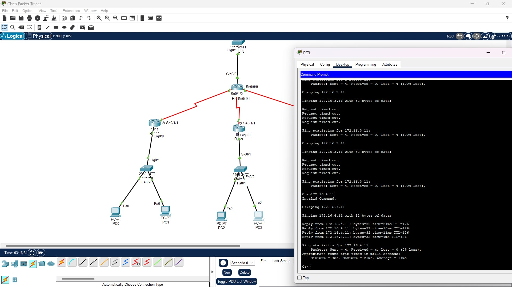
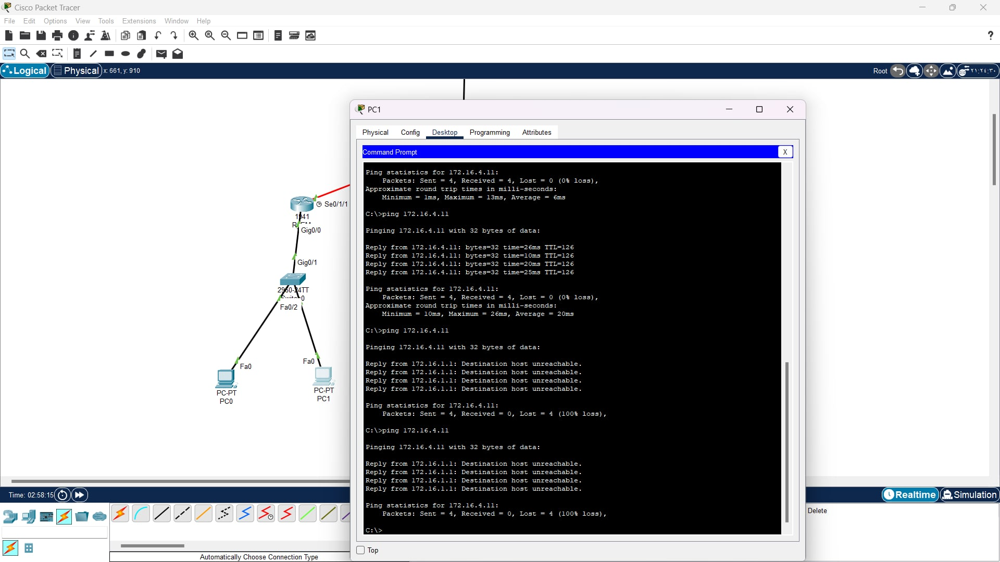
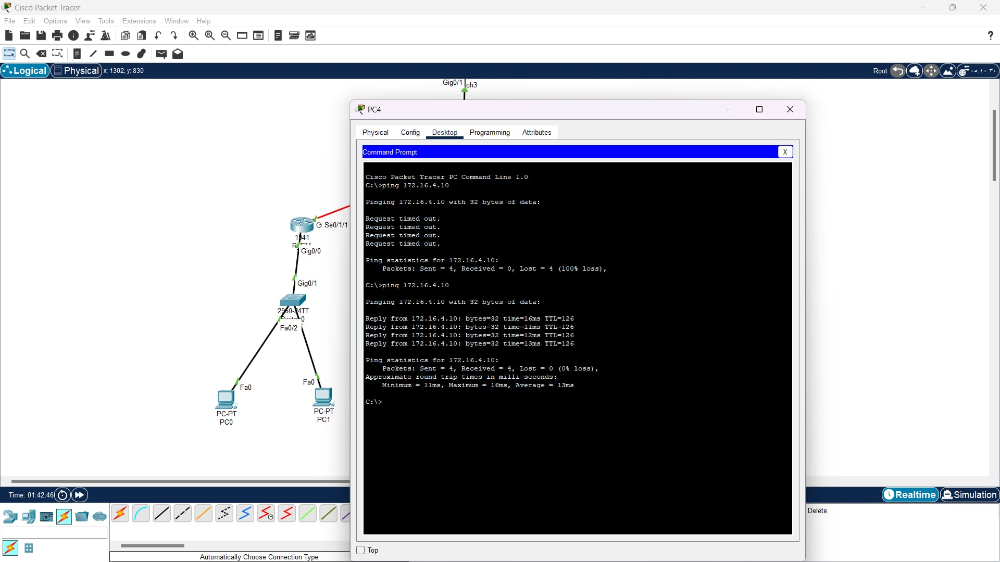
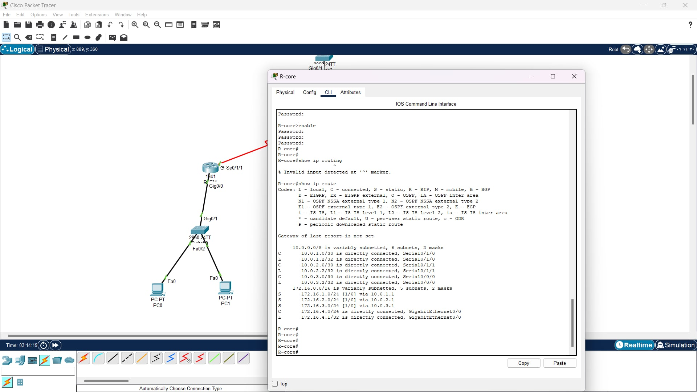
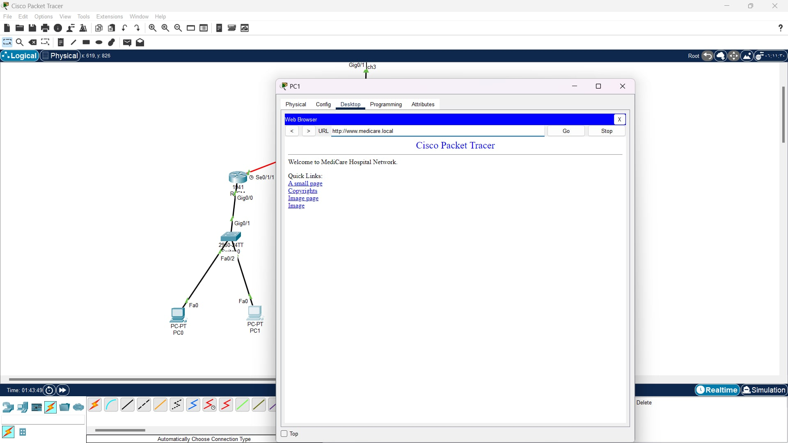
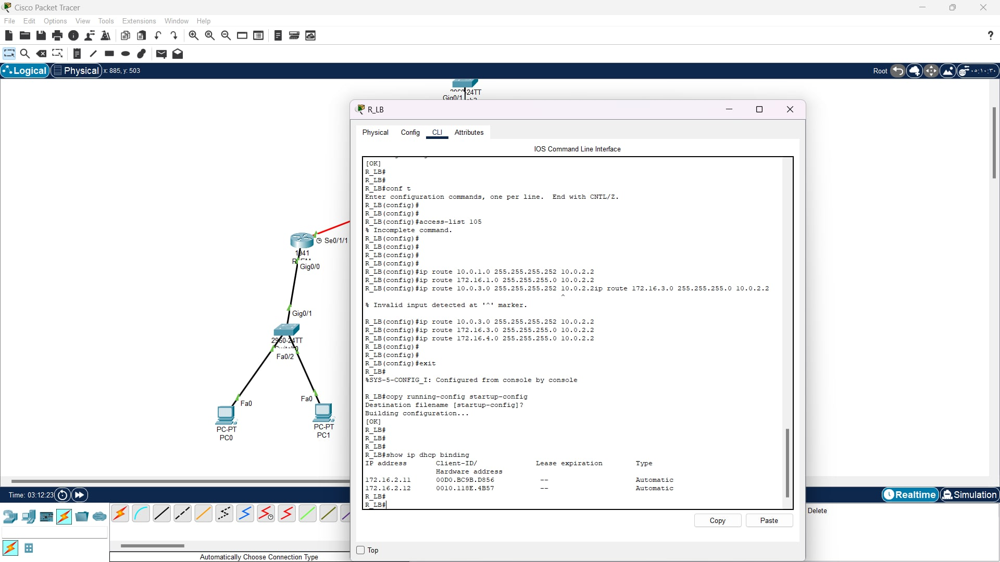
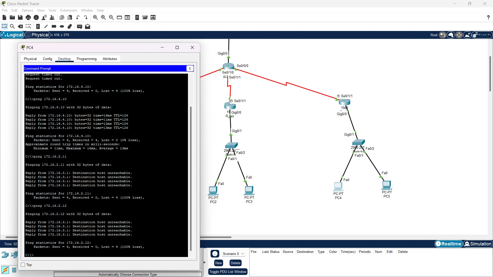
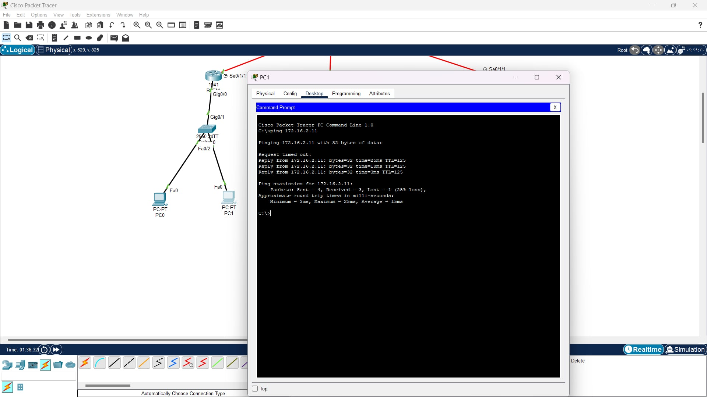
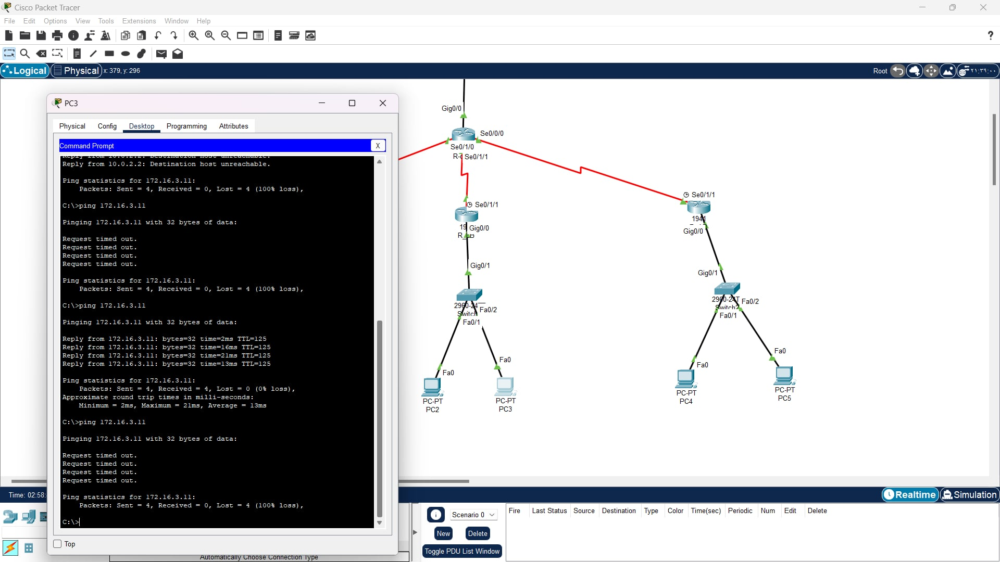
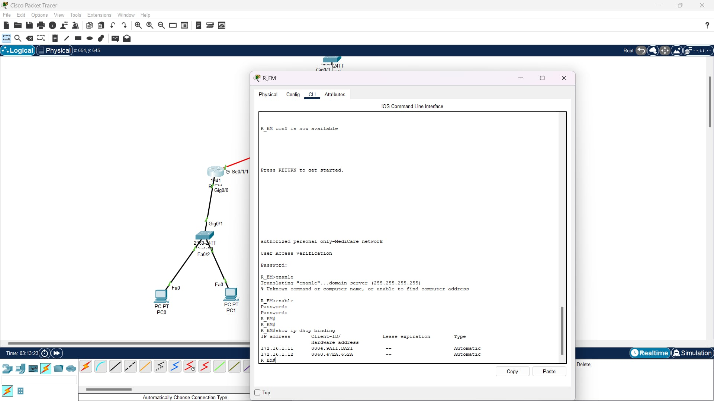

# Enterprise CCNA Networking & Packet Tracer Design

Welcome to my computer networking repository! This project presents a full enterprise network architecture designed, configured, and validated using **Cisco Packet Tracer**.

## Project Overview
The primary objective of this project is to build a secure, scalable, and fully functional multi-site enterprise network with dynamic routing, VLAN segmentation, automated IP allocation, and traffic control.

* **Main Simulation File:** `finaly.pkt`
* **Status:** Completed & Verified

---

## Lab Documentation & Screenshots

* **Network Topology:**
  

* **Router & Switch Configurations:**
  
  

* **OSPF & Routing Tables:**
  
  

* **DHCP & ACL Security:**
  
  

* **Ping Testing & Validation:**
  
  

* **Web Server Access:**
  

---

## Technical Skills Implemented
* **Dynamic Routing:** OSPF configuration across core and edge routers.
* **VLANs & Trunking:** IEEE 802.1Q and Router-on-a-Stick.
* **IP Services:** DHCP Server implementation and bindings.
* **Network Security:** Extended Access Control Lists (ACL 105).
* **Web Services:** Local intranet deployment (`www.medicare.local`).

## How to Run
1. Download **Cisco Packet Tracer**.
2. Open `finaly.pkt` to inspect configurations and test connectivity.
